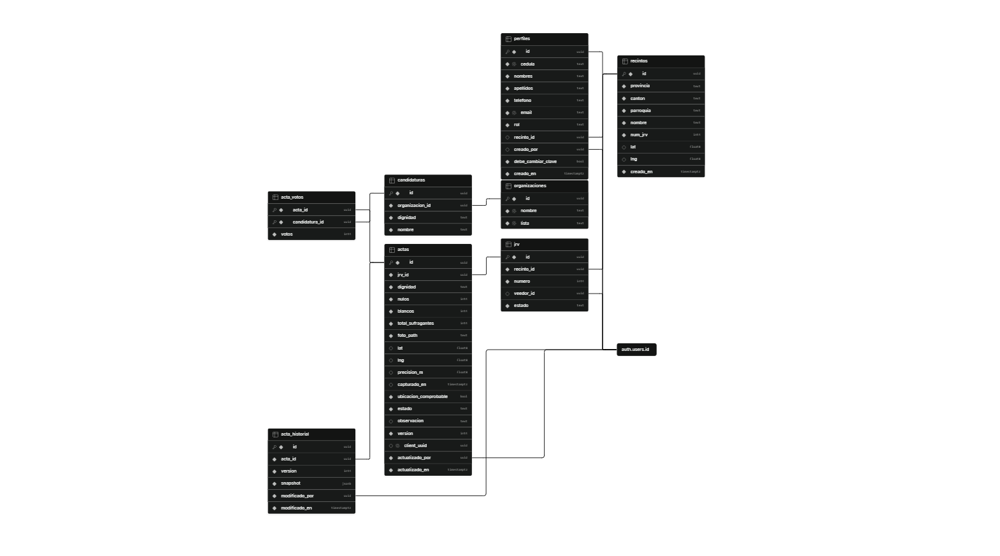
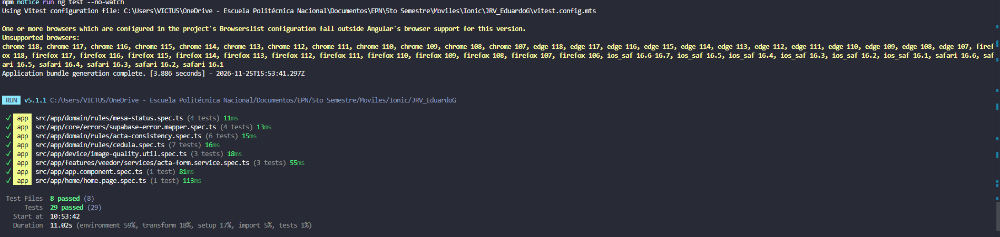
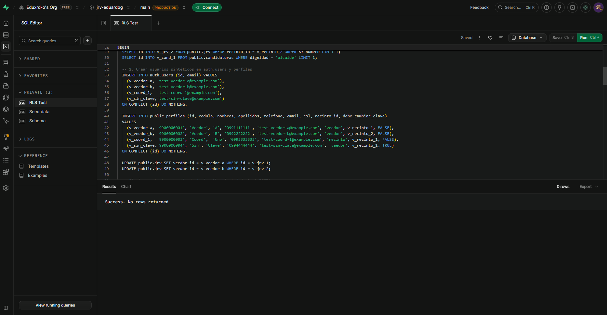

# Control Electoral JRV — Eduardo Ganchala (Equipo 6)

Aplicación móvil desarrollada en **Ionic Angular (standalone) + Capacitor + Supabase** para la gestión, registro, validación y supervisión del escrutinio electoral desde las Juntas Receptoras del Voto (JRV), con soporte de **3 roles** (`provincial`, `recinto`, `veedor`) y **modo offline con sincronización y control de conflictos (R10)**.

- **Asignatura:** Desarrollo de Aplicaciones Móviles · ESFOT (EPN)
- **Estudiante:** Eduardo Fabricio Ganchala Castillo
- **Equipo de consenso arquitectónico:** Equipo 6 (Eduardo Ganchala · Josué Ortiz)
- **Línea base documental:** [docs/adr/](docs/adr/)

---

## 1. Requisitos cubiertos (R1–R10)

| Req. | Descripción | Implementación principal |
|---|---|---|
| **R1** | Datos iniciales (Pichincha – Quito, 4 recintos, 14 JRV, 5 organizaciones, 5 alcaldía, 5 prefectura) | `supabase/seed.sql` + trigger `trg_crear_jrvs_recinto` |
| **R2** | Sin autorregistro; jerarquía provincial → recinto → veedor; cédula ecuatoriana validada | Edge Functions `crear-coordinador-recinto` y `crear-veedor` + `domain/rules/cedula.ts` |
| **R3** | Login por cédula, clave inicial `Ecuador2026`, cambio obligatorio y recuperación por correo | RPC `email_por_cedula`, `marcar_clave_cambiada`, `cambioClaveGuard` y política RLS |
| **R4** | Coordinador provincial: recintos, coordinadores, avance, mapa GPS y dashboard | `features/provincial/` + vistas SQL `security_invoker` + Leaflet/OpenStreetMap |
| **R5** | Coordinador de recinto: mesas/estados, crear veedores, asignar/reasignar JRV y corregir actas/fotos | `features/recinto/` + reutilización de `ActaFormPage` |
| **R6** | Veedor: solo mesas asignadas, actas Alcalde/Prefecto, consistencia de totales, `OBSERVADA` y correcciones | `features/veedor/` + `domain/rules/acta-consistency.ts` + RPC `guardar_acta` |
| **R7** | Cámara/galería, comprobación de nitidez (Laplaciano) y GPS (o etiqueta *Ubicación no comprobable*) | `src/app/device/` + permisos en `AndroidManifest.xml` |
| **R8** | Backend Supabase con RLS por rol/pertenencia, bucket privado `actas` y aislamiento de veedor | `supabase/migrations/202611250001_schema_rls_views.sql` + `supabase/tests/rls.sql` |
| **R9** | Arquitectura en capas, Signals + `Estado<T>`, Reactive Forms y manejo centralizado de errores | `core/`, `domain/`, `data/`, `device/`, `shared/`, `features/` + ESLint `no-restricted-imports` |
| **R10** | *(Extra)* Cola offline en Dexie (IndexedDB), fotos en `@capacitor/filesystem`, sync automático y conflictos por `version` | `src/app/data/offline/` + pestaña `Pendientes` |

---

## 2. Arquitectura por capas (`ADR-001`, `ADR-004`, `ADR-005`)

```text
features/ (Presentación Ionic Standalone + Reactive Forms)
    │  (inyecta Stores con Signals y servicios de dominio; NUNCA importa Supabase ni data/)
    ▼
domain/ (TypeScript puro: models/, rules/, ports/ — sin Angular, Ionic ni Supabase)
    │  (enlazado vía InjectionToken en core/di/repository.tokens.ts)
    ▼
data/ (Única capa que importa @supabase/supabase-js, Dexie y Storage)
    ├── supabase/   (Repositorios Postgres + RPCs + Vistas)
    ├── storage/    (Bucket privado 'actas' + URLs firmadas)
    ├── functions/  (Invocación de Edge Functions sin service_role)
    └── offline/    (DexieDb + PhotoLocalStore + OutboxSyncService)
    ▼
Backend Supabase (Postgres + RLS + Triggers + Storage Privado + Edge Functions)
```

La separación se verifica automáticamente con ESLint (`no-restricted-imports` en `eslint.config.js`).

---

## 3. Modelo de datos y seguridad (`ADR-002`, `ADR-008`, `ADR-009`)

- **Tablas normalizadas:** `recintos`, `jrv`, `organizaciones`, `candidaturas`, `perfiles`, `actas`, `acta_votos`, `acta_historial`.
- **Seguridad en doble barrera:**
  - `authGuard`, `cambioClaveGuard` y `rolGuard` protegen la navegación en UX.
  - **Row Level Security (RLS)** en Postgres exige `auth_clave_actualizada() = true` y filtra por `rol`, `recinto_id` y `jrv.veedor_id = auth.uid()`.
  - Las claves administrativas (`SUPABASE_SERVICE_ROLE_KEY`) existen **exclusivamente** en el servidor de Edge Functions; el cliente móvil usa únicamente la clave pública (`publishable/anon key`).
  - Las fotos se guardan en el bucket **privado** `actas/{recinto_id}/{jrv_id}/{dignidad}.jpg` con acceso por URL firmada.
- **Vistas SQL del Dashboard (`security_invoker = true`):** `resultados_por_candidato_recinto`, `resultados_blancos_nulos_recinto`, `avance_actas_recinto` (soportan incluir o excluir actas `OBSERVADA`).



---

## 4. Instalación y configuración (sin secretos)

### Prerrequisitos
- Node.js `>= 22` (probado en `v24.21.0`) y npm `>= 10`
- Ionic CLI / Angular CLI 22 (`@ionic/angular` 9, Capacitor 8)
- Proyecto en **Supabase** (plan gratuito)
- Android Studio / JDK 21 (para compilar el APK)

### Paso 1: Instalar dependencias
```powershell
npm install
```

### Paso 2: Configurar credenciales públicas de Supabase (sin subir secretos a Git)
Edita `src/environments/environment.ts` y `src/environments/environment.prod.ts` con la URL y la clave **Publishable/Anon** de tu proyecto Supabase (**nunca** `service_role` ni `sb_secret_`):

```ts
export const environment = {
  production: false,
  supabaseUrl: 'https://TU-PROYECTO.supabase.co',
  supabaseAnonKey: 'TU-SUPABASE-PUBLISHABLE-KEY',
  sharpnessThreshold: 100,
};
```

Para evitar commitear tus credenciales locales por accidente:
```powershell
git update-index --skip-worktree src/environments/environment.ts src/environments/environment.prod.ts
```

### Paso 3: Aplicar migraciones, datos iniciales y Edge Functions en Supabase
1. En **Supabase → SQL Editor**, ejecuta en orden:
   - `supabase/migrations/202611250001_schema_rls_views.sql`
   - `supabase/seed.sql`
2. Despliega las Edge Functions:
   ```powershell
   npx supabase login
   npx supabase link --project-ref <TU-PROJECT-REF>
   npx supabase functions deploy crear-coordinador-recinto
   npx supabase functions deploy crear-veedor
   ```
3. Crea el primer usuario **Coordinador Provincial** en **Authentication → Users → Add user** con contraseña `Ecuador2026` y vincúlalo en `perfiles` usando `supabase/bootstrap_provincial.sql`.

---

## 5. Ejecución y compilación del APK Android

### Desarrollo en navegador
```powershell
npm start
```

### Compilación web + sincronización Android + APK
```powershell
npm run build
npx cap sync android
cd android
.\gradlew.bat assembleDebug
```
El APK instalable se genera en: `android/app/build/outputs/apk/debug/app-debug.apk`.

### Calibración de nitidez (`ADR-003`)
- Algoritmo: **varianza del Laplaciano** (kernel 3×3 en escala de grises) + brillo medio mínimo (`35`) en `src/app/device/image-quality.util.ts`.
- Umbral inicial acordado en consenso: **`sharpnessThreshold = 100`** (configurable en `environment.ts`).

---

## 6. Estrategia de pruebas en 3 niveles (`ADR-010`)

1. **Nivel 1 — Pruebas unitarias (Vitest):**
   ```powershell
   npm run test:unit
   npm run eslint
   ```
   Cubre: `cedula.spec.ts`, `acta-consistency.spec.ts`, `mesa-status.spec.ts`, `image-quality.util.spec.ts`, `supabase-error.mapper.spec.ts`, `acta-form.service.spec.ts` (**29 pruebas en verde**, 0 errores de ESLint).
2. **Nivel 2 — Seguridad RLS e integridad SQL (Supabase):**
   Ejecutar `supabase/tests/rls.sql` en el SQL Editor (corre en `BEGIN ... ROLLBACK` y valida 6 aserciones críticas de R8, R3, R6 y R10).
3. **Nivel 3 — Pruebas manuales en Android:**
   Lista de los 11 casos mínimos y evidencias en [docs/pruebas-manuales.md](docs/pruebas-manuales.md) y `docs/evidencias/`.





---

## 7. Credenciales de demostración (no sensibles)

- **Contraseña inicial para cuentas recién creadas (R3):** `Ecuador2026` (cambio obligatorio en el primer inicio de sesión).
- **Roles de demostración:** creados jerárquicamente desde el Coordinador Provincial inicial (cédulas de prueba válidas como `1710034065`, `0926687856`, `3000000004`, con correos alias para validar recuperación y confirmación).

---

## 8. Uso de Inteligencia Artificial

El detalle completo de herramientas, consultas realizadas, decisiones aceptadas/descartadas y verificaciones humanas se encuentra en [docs/anexo-uso-ia.md](docs/anexo-uso-ia.md).
